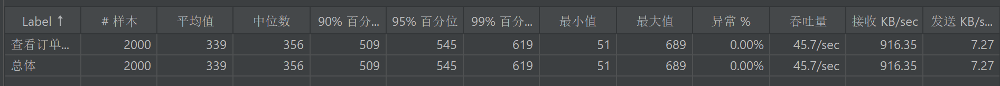
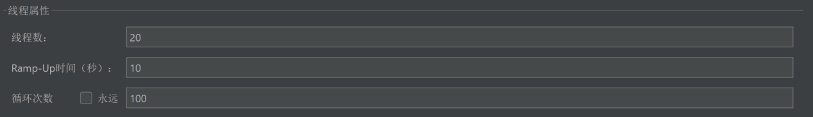
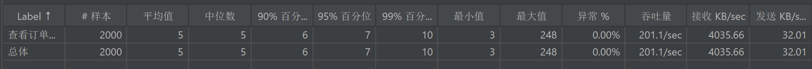
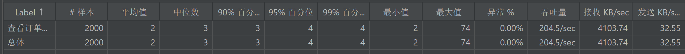
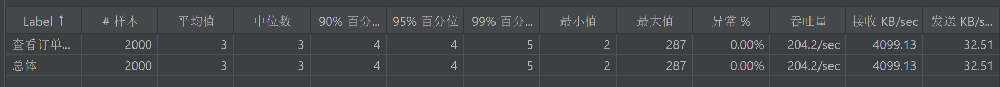
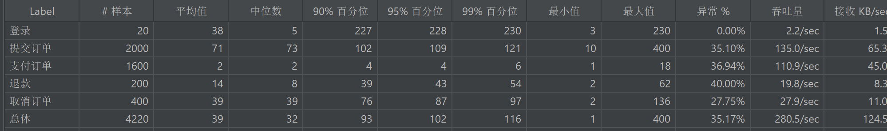
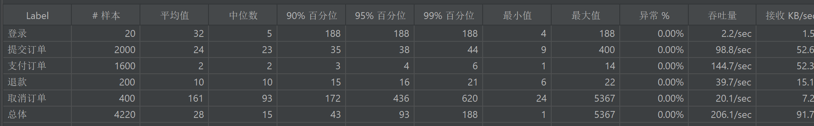
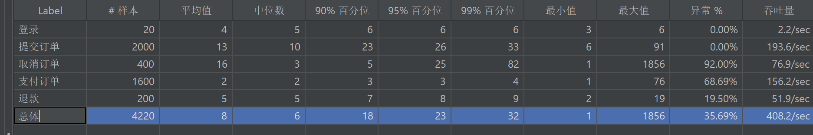
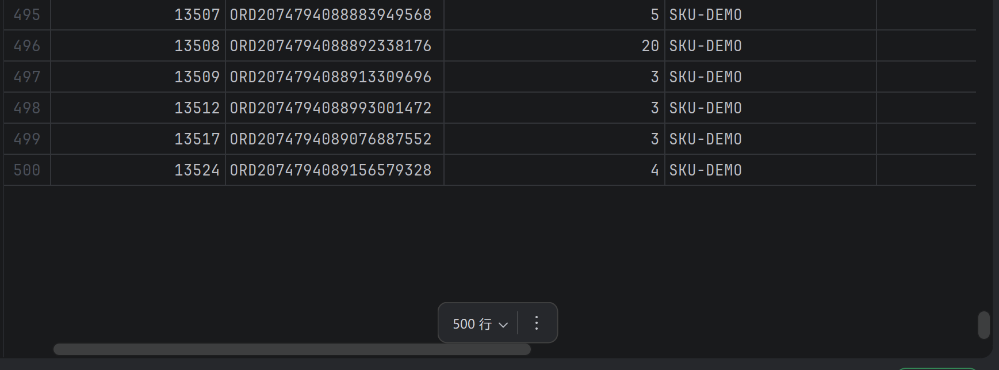

# 订单链路压测记录

> 由 `order-stress-test.docx` 转换，原始 Word 文件保留在仓库中。

模拟20个用户 每个用户查询100次

平均值339ms

在数据库加了索引之后

平均值 5 ms

加入Redis

平均值 2 ms

加入分布式锁

平均值 3 ms

模拟20个用户

Caused by: com.mysql.cj.jdbc.exceptions.MySQLTransactionRollbackException: Deadlock found when trying to get lock; tryrestarting transaction —— 尝试获取锁时发现死锁；请重新启动事务

死锁原因是 下单的时候 先扣库存再改订单

取消和退款的时候 先改订单 再回复库存

测试100个库存是否超卖

